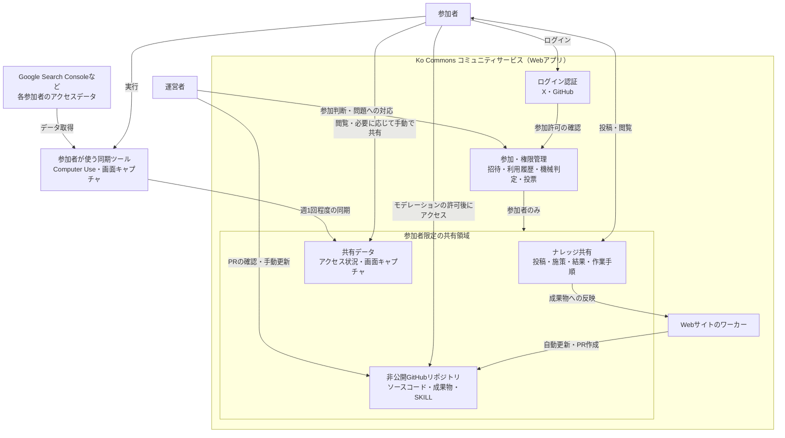
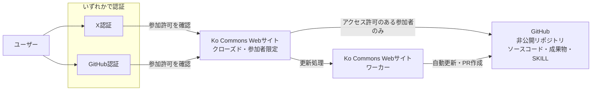

# Ko Commons

## ここは何か

Ko Commonsは、コ開発を通じて成長したい人たちが集う、招待制のクローズドコミュニティです。

※最初から完璧な運用を目指すのではなく、実際に運用しながら調整していきます。

## サービス構成

参加者・運営者と、各機能の関係や情報の流れを示します。外枠がKo Commonsコミュニティサービス全体で、その中の共有領域は、参加者がアクセスできる範囲を表しています。ワーカーは成果物を更新するための仕組みで、参加者が直接操作するものではありません。

同期はできるだけ自動化し、必要な部分は手動で補います。

## システム構成

ユーザーはXまたはGitHubのいずれかで認証し、参加許可を確認したうえで、クローズドなKo Commons Webサイトを利用します。

GitHubへのアクセスには、Webサイトの利用とは別にモデレーションによる許可が必要です。

## 大切にすること

誰かに頼ることを前提とせず、一人ひとりが主体的に取り組み、自分の力を伸ばしていくことを基本とします。

アドバイスは、成長を助ける副次的なものです。その質にはばらつきがあるため、参考として受け止め、取り入れるかどうかは各自で判断します。アドバイスをする側も、採用されることを期待しすぎないようにしましょう。

特定の実力者を「ヒーロー」として頼りすぎないことも大切です。実力者から無料でアドバイスをもらうためのコミュニティではありません。

参加者それぞれの試行錯誤を持ち寄ることに価値を置きます。実績のある人による指導を前提とせず、うまくいったことも、失敗したことも学びとして共有していきます。

コミュニティは性善説を前提とし、参加者による自浄作用を期待します。

- ギブとテイクの精神を大切にする。
- AIスロップを過剰に生み出さないようにする。
- 各サービスにおける利用規約などを遵守する。

## 向いている参加姿勢・向いていない参加目的

自分にとってのメリットを期待するのは自然なことです。自分が得るものだけでなく、コミュニティに持ち寄れるものにも関心を持てるかを大切にします。

### 向いている参加姿勢

- 自分で試し、その経験を共有できる範囲で持ち寄る。
- 成功だけでなく、失敗や「まだ分からないこと」も共有する。
- 他の参加者の助言を参考にしつつ、自分で判断して取り組む。
- 自分の成長と、他の参加者への貢献を両方楽しむ。
- 情報の扱いを守り、コミュニティを少しずつ整えることに参加する。

### 向いていない参加目的・姿勢

- 自分が得られるメリットばかりを求め、知見や経験を持ち寄ることには関心がない。
- 実力者から無料で教えてもらうことを主な目的にする。
- 自分の課題を、運営者や他の参加者に解決してもらうことを期待する。
- 即効性のあるノウハウや、確実に成果が出る答えを求める。
- 自分の情報は一切共有せず、他の参加者には詳しい情報開示を求める。
- 他の参加者を、売り込み先や見込み客として扱う。
- コミュニティ内の情報を、外部発信や自分の権威づけに使おうとする。
- 自分のアドバイスが採用されないことを、自分への否定として受け止める。
- 売上や実績で参加者を序列化し、発言の価値を判断する。
- 運営途中の不便さや未確定な部分を受け入れられず、完成されたサービスを求める。

## 参加条件と利用ルール

- 自身のサービスまたはアプリをローンチ済みであることを必須とします。
- 利用できるのは、招待されたユーザーのみです。
- XまたはGitHubアカウントでのログインを必須とします。
- 利用には、既存の利用者の一定数の賛成が必要です。
- 公開されたルールに基づき、機械判定と参加者のリジェクト投票を組み合わせた判断により、コミュニティからリジェクト（退出）される場合があることへの同意を必須とします。
- 活動状況を確認できるように、利用者の最終ログイン日時を表示します。

### 参加判断の方針

参加にあたっては、コミュニティの趣旨への理解と、共有した情報や他の参加者を尊重する姿勢を大切にします。参加を見送る場合も、その人の能力や人格を評価するものではありません。

参加人数は、コミュニティの状況と運営が対応できる範囲を確認しながら、段階的に増やしていきます。一度に大幅な人数の拡大は行いません。参加枠を増やす際は、事前にコミュニティ内で相談し、増やす人数や時期を決めます。

必要な賛成数などの具体的な条件は、運用しながら明確にしていきます。

### 参加の継続と問題への対応

各自が無理なく続けられる範囲で、知見や経験を持ち寄ることを大切にします。

コミュニティからの退出判断には、機械的なルールによる判定と参加者による投票を組み合わせます。利用状況や投票数などが定められた基準に達した場合は、退出の検討対象とし、運営者が事実関係を確認したうえで、参加者の投票結果と合わせて判断します。機械判定やネガティブ投票の数だけで退出を確定することはありません。

利用基準、投票の成立条件、退出の判断条件などのルールは、適用を開始する前に公開します。具体的な数値や手続きは、コミュニティ内で相談して決めます。

問題が起きた場合は、当事者だけで抱え込まず、運営者に相談できるようにします。性善説や自浄作用だけに頼らず、運営者が状況を確認し、必要に応じて対応します。

## 活動と情報共有

### ナレッジと成果物

参加者のナレッジをもとに、GitHub上の成果物を更新していきます。更新は内容に応じて、ワーカーによる自動更新、ワーカーが作成したPull Requestの確認、運営者による手動更新のいずれかで行います。成果物へのアクセスには、モデレーションによる許可が必要です。

Ko Commons Webサイトとワーカーのソースコードは、成果物と同じ非公開GitHubリポジトリで、アクセスを許可された参加者に共有します。

### 共有する範囲

プロダクト全体や、事業上公開できない情報まで共有することは求めません。各自が共有できる範囲で、施策、失敗例、作業手順などを持ち寄ります。

コミュニティ内で共有された情報は、コミュニティの外へ持ち出さないでください。外部への転載・公開や、コミュニティ外の第三者への共有もこれに含みます。対象は、投稿、データ、画面キャプチャ、共有されたSKILLや成果物などです。

ただし、自分が共有した自分自身の情報（自分のプロダクトのデータや施策など）は、引き続き自由に扱えます。他の参加者の情報が含まれる場合は、その部分を除いて扱ってください。

GitHub上の成果物もコミュニティ内で共有し、アクセスできる範囲を許可された参加者に限定します。

共有情報の保存期間や退会後の扱いは、運用開始にあたって明確にします。削除や取り下げを希望する場合の相談先も設けます。

### 試行錯誤の記録

施策を共有する際は、可能な範囲で次の情報を残します。

- 何を改善したくて、いつ、何を変えたか。
- 対象となるプロダクトやメディアの特徴。
- 観測できた結果と、まだ分からないこと。

経験談、仮説、確認できた結果を区別して共有します。数字の変化だけで施策の効果が確定するとは限らないため、結果を解釈する際は、ほかの変更や外部要因も考慮します。

作業手順は、必要に応じてAIのSKILLなどの形でも共有します。手順の共有と、実際に行った施策や結果の記録は、それぞれ残していきます。

### アクセス状況の同期

週に1回程度、アクセス履歴などの状況を同期します。

Google Search Consoleなどのデータを取得する際は、Computer Useを使い、画面キャプチャも含めて同期する仕組みを配布します。
なるべく自動化を目指しますが、手動になる部分も想定されます。

## 運営が引き受ける範囲

初期の運営では、試行錯誤を共有する場づくりと、共有された知見を成果物に反映することを中心に進めます。個別の助言や成果の保証、網羅的なデータ収集・解析は、初期の提供範囲には含めません。

招待の判断、問題への対応、成果物の更新は、運営者が継続して対応できる範囲で行います。新しい活動や仕組みは、参加者の需要と運営の負担を確認しながら追加していきます。

## 運営者候補

- わたくし
- moみじまん
- nani氏

## 今後の予定

スマートフォンアプリは、次のフェーズで対応する予定です。
